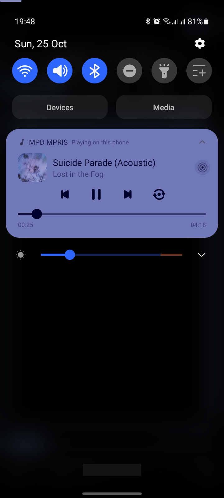
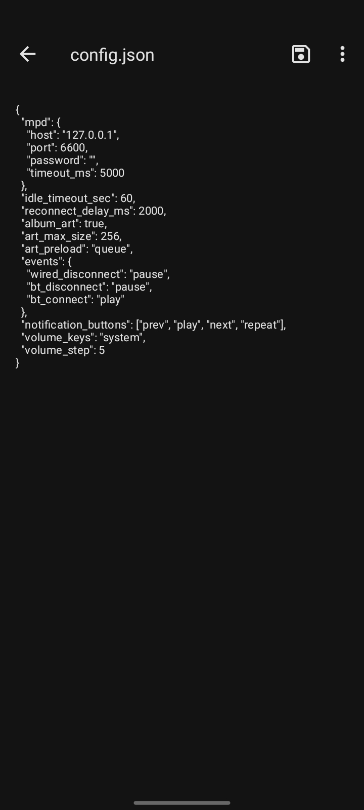
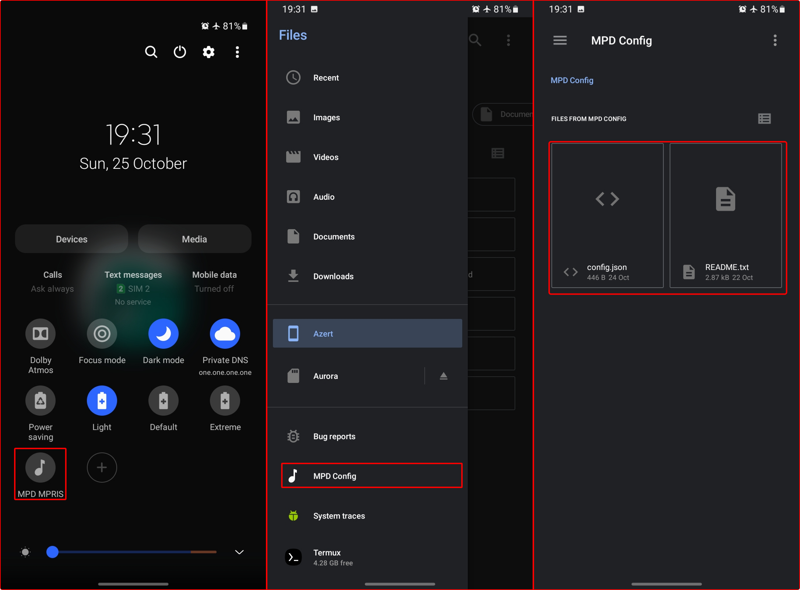

# MMNA - MPD Media Notification Android

MMNA is an Android application that receives media metadata over TCP socket and displays it as Android media notification, including album art and it is fast!.

### Features

- Displays media notification (obviously).
- Supports album art.
- Caches album art for faster loading.
- Uses a plain JSON configuration file.
- Can be enabled or disabled via QS Tiles.
- Without any UI.

### Disclaimer

MMNA originally for personal use and written with help from AI (free), because I've never written an Android app before. At least it works as expected :D

Media player icon (play, pause, next, random, close, repeat) used on app was created by myself. Except for mpd icon as app icon later will be replaced (maybe).

### How to use

After install, apps will create a JSON file that can be accessed using SAF (only when deactivated). If file not appear, touch and hold quick settings, or turn it on and off.

You can reset your configuration with delete JSON file and then touch and hold quick settings.

